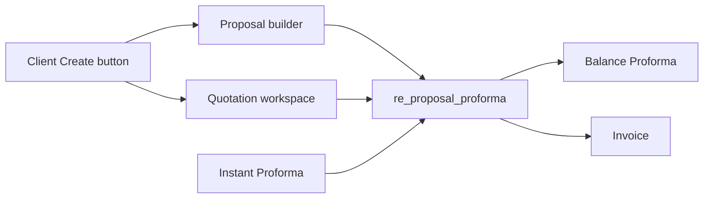

# Quotation flow beside Proposal

Quotation becomes a third way to start a **normal proforma**. Instant proforma stays as it is. Proposal, balance, payment, and invoice keep using `re_proposal_proforma` snapshots.

## Locked decisions (from Oct 24 analysis)

- Notes → `re_quotation.notes_json` only (not `re_plan_client_notes`)
- Mode via `location.state.mode = 'quotation'`
- QTN numbering via `re_proforma_counters` (`QTN`)
- PDF via existing [QuotationPage.jsx](client/src/features/invoices/pages/QuotationPage.jsx) (`docTypeFromURL`)
- New `QuotationActions` / `QuotationTable` (mirror proposals; do not overload ProposalActions)
- Assign-to-BD unchanged; Instant Proforma not wired to quotations

## What was removed (do not restore)

- `82b7906`: `re_calculator_transactions` dropped
- Later commits retired quotation UI / Assign Quotation / Coming Soon (`4320708`)
- Do not revive `re_quotation_status` as primary store — use `re_quotation.status`
- See [QUOTATION_FLOW_REMOVAL_ANALYSIS.md](docs/QUOTATION_FLOW_REMOVAL_ANALYSIS.md)

## Reuse

- `classifyProformaServices`, ads helpers, `getNextProformaNumber` pattern
- Mirror `sendProposalToClient` for quotation (do not revive old workflow → `re_quotation_status`)
- Extend [GenerateProformaModal.jsx](client/src/features/history/components/GenerateProformaModal.jsx), do not rewrite

## Data

New file: [server/sql/2026-10-quotation-tables.sql](server/sql/2026-10-quotation-tables.sql)

- `re_quotation`: `QTN-n`, `txn_id`, proposal-matching status ENUM, totals, `discount_json`, `notes_json`, `created_by`
- `re_quotation_services` / `re_quotation_ads` with FK CASCADE
- `INSERT IGNORE` QTN into `re_proforma_counters`
- `re_proposal_proforma`: nullable `proposal_id` + nullable `quotation_id`; exactly one set

## API

New [re_quotationController.js](server/revenue_engen_server/re_controller/re_quotationController.js) + [re_router.js](server/revenue_engen_server/re_router/re_router.js): create, getById, byClient, getAll, status, delete (block if proforma), save services/ads/notes, send.

[createProforma](server/revenue_engen_server/re_controller/re_proposalController.js): `proposal_id` **or** `quotation_id`; same snapshot shape; quotation status → `proforma_generated`.

**High risk:** after `proposal_id` becomes nullable, keep proposal subqueries (~L488–573, delete ~L598, ~L1253) correctly scoped; [ProformaManagerModal.jsx](client/src/features/history/components/ProformaManagerModal.jsx) must filter by `quotation_id` for quotation-backed rows.

## Workspace

Activate Create Quotation on Admin/BD client details + New Quotation on [ClientServiceHistoryPage.jsx](client/src/features/history/pages/ClientServiceHistoryPage.jsx): POST draft → navigate ServicesLanding with `{ mode: 'quotation', quotationId }`.

Wire [ServicesLandingPage.jsx](client/src/features/calculator/pages/ServicesLandingPage.jsx), [GraphicCalculator.jsx](client/src/features/calculator/components/GraphicCalculator.jsx), [AdsCampaignCalculator.jsx](client/src/features/calculator/components/AdsCampaignCalculator.jsx), [useGraphicCalculatorNotes.js](client/src/features/calculator/hooks/useGraphicCalculatorNotes.js). Default calculator endpoints unchanged.

## Lists / proforma

- Client history Proposals | Quotations; Accounts [HistoryHubPage.jsx](client/src/features/history/pages/HistoryHubPage.jsx) Quotation sub-tab → `QuotationHistoryPage.jsx`
- GenerateProformaModal source picker; ProformaHistory shows `QTN-n` when `quotation_id` set

## Build order

1. SQL migration
2. Quotation controller + routes
3. createProforma quotation path + proposal query guards
4. Create Quotation + calculator mode
5. Client history Quotation tab + actions
6. HistoryHub Quotation page
7. GenerateProformaModal + ProformaManagerModal + ProformaHistory QTN-n

## New files

- `server/sql/2026-10-quotation-tables.sql`
- `server/revenue_engen_server/re_controller/re_quotationController.js`
- `client/src/features/history/components/QuotationTable.jsx`
- `client/src/features/history/components/QuotationActions.jsx`
- `client/src/features/history/pages/QuotationHistoryPage.jsx`
