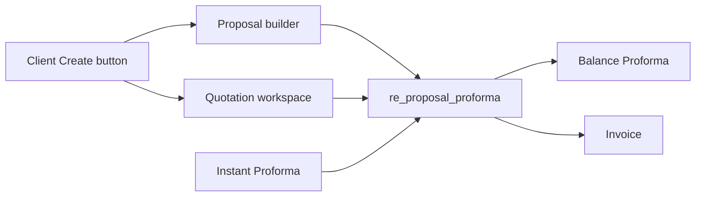

# Quotation flow beside Proposal

Quotation becomes a third way to start a **normal proforma**. Instant proforma stays as it is. Proposal, balance proforma, payment, and invoice keep using `re_proposal_proforma` snapshots, so a quotation-backed proforma behaves like a proposal-backed one.

## Data

New SQL migration, do not restore `re_calculator_transactions`.

- `re_quotation`: `id`, `client_id`, `quotation_number` (`QTN-n`), `txn_id`, `status` (same values proposals use: draft, sent, approved, client_approved, proforma_generated, and the later payment statuses), `grand_total_excl_gst`, `discount_json`, `notes_json`, `created_by`, timestamps.
- `re_quotation_services`: graphic / SEO rows the service calculator already collects (service, category, editing type, qty, addons, additional services, total).
- `re_quotation_ads`: ads calculator rows (category, budget, percent, charge, total).
- `re_proposal_proforma`: `proposal_id` becomes nullable; add nullable `quotation_id`. Exactly one of the two is set. Snapshots (`pricing_snapshot`, `ads_snapshot`, `notes_snapshot`, `discount_snapshot`) stay the columns proforma, balance, and invoice already read.

## Create and edit

The dead **Create Quotation** button in [AdminClientDetailsPage.jsx](client/src/features/admin/pages/AdminClientDetailsPage.jsx) and [BDClientDetailsPage.jsx](client/src/features/bd/pages/BDClientDetailsPage.jsx) creates a draft row and opens the workspace. The same choice is added next to **New Proposal** on [ClientServiceHistoryPage.jsx](client/src/features/history/pages/ClientServiceHistoryPage.jsx).

Workspace reuses [ServicesLandingPage.jsx](client/src/features/calculator/pages/ServicesLandingPage.jsx), [GraphicCalculator.jsx](client/src/features/calculator/components/GraphicCalculator.jsx), the ads calculator, and [useGraphicCalculatorNotes.js](client/src/features/calculator/hooks/useGraphicCalculatorNotes.js). A `mode=quotation` flag sends saves to the new tables. Default calculator saves stay on their current endpoints so proposal and instant proforma are unchanged. Notes UI stays; persistence goes to `re_quotation.notes_json` so a quotation id cannot collide with a proposal id in `re_plan_client_notes`.

View / Edit from history opens this same workspace.

## Same actions as a proposal

Quotation rows get the action set in [ProposalActions.jsx](client/src/features/history/components/ProposalActions.jsx): View/Edit, Send to client, Mark approved, Mark client response, Generate Proforma, View Proformas, Download PDF, Delete (blocked once a proforma exists). Status updates hit `re_quotation`. PDF prints the existing quotation document in [QuotationPage.jsx](client/src/features/invoices/pages/QuotationPage.jsx) from the new rows, with the GST / non-GST letterhead chosen on that open. Assign-to-BD is left as it is today.

## Lists

- Client history ([ClientServiceHistoryPage.jsx](client/src/features/history/pages/ClientServiceHistoryPage.jsx)): tabs **Proposals** and **Quotations**, each with its own table and count.
- Accounts sidebar ([HistoryHubPage.jsx](client/src/features/history/pages/HistoryHubPage.jsx)): **Quotation** directly under **Proposal**, listing every quotation (client, number, date, amount, status, the same actions).

## Create Proforma from either source

[GenerateProformaModal.jsx](client/src/features/history/components/GenerateProformaModal.jsx) picker shows two groups: approved proposals and approved quotations. Choosing one fills the same service preview and the same amount math (`classifyProformaServices`, discount, previous balance, GST 18% on the service total).

[createProforma](server/revenue_engen_server/re_controller/re_proposalController.js) accepts `quotation_id` or `proposal_id`. For a quotation it builds `serviceItems` and `adsItems` in the same JSON shape it already snapshots from `pricing_table_json`, including ads service-charge rows. It writes one `re_proposal_proforma` row, then sets that quotation’s status to `proforma_generated` the way it already does for proposals. The opened document stays `doc=proforma`. Proforma history’s proposal column shows `QTN-n` when `quotation_id` is set.

Instant Proforma is not wired to quotations.
