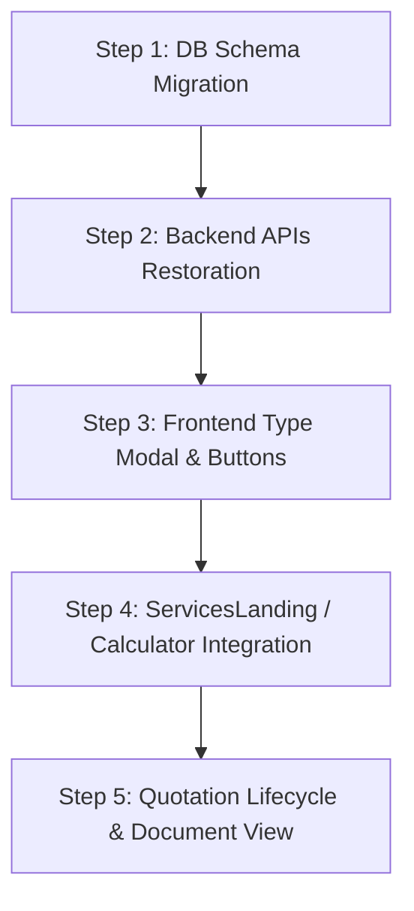

# 📋 Quotation Flow Removal Analysis & Restoration Guide
**Repository:** DoaGuru Infosystems - Revenue Engine  
**Author:** Technical Architecture Audit  
**Date:** October 2026  
**Language:** Hindi + Technical English (Team Handover Ready)

---

## 📌 1. Executive Summary (Overview)

Revenue Engine me pehle **Quotation Creation and Management Workflow** exist karta tha, jiske madhyam se:
1. Client Details ya Calculator se **Quotation** generate hoti thi.
2. User **With GST (18%)** ya **Without GST** select karta tha.
3. Quotation database me `re_calculator_transactions` table me save hoti thi.
4. History me Quotation ka lifecycle status track hota tha (`Draft` → `Sent to Client via WhatsApp/Email` → `Approved / Rejected` → `Generate Proforma`).
5. Admin BD ko Quotation assign kar sakta tha (`Assign Quotation`).

**Kyun hataya gaya tha?**  
Jab naya **Proposal Builder (`/proposal-builder/:clientId`)** aur **Proforma Invoice Manager** implement hua, tab legacy quotation flow ko duplicate samajhkar frontend UI, history tabs aur backend se step-by-step retire kar diya gaya tha.

Neeche iska complete **Commit-by-Commit Audit**, **Deleted Components List**, aur **Wapas Restore karne ka Step-by-Step Action Plan** diya gaya hai.

---

## 🕒 2. Commit-by-Commit Audit (Kahan aur Kab Kya Hataya Gaya)

| Commit Hash | Date | Commit Message | Kya Hataya Gaya (Removed Items) |
|---|---|---|---|
| **`4320708`** | `2026-10-19` | `feat: add Create Balance Proforma modal, update button to Create Quotation...` | Client Details page par quotation button ko empty/inactive placeholder banaya gaya: `<button title="Create Quotation (Coming Soon)">Create Quotation</button>`. |
| **`82b7906`** | `2026-10-13` | `feat: add dynamic additional services support... retire legacy calculator table` | **Database:** `re_calculator_transactions` table ko DROP kiya gaya.<br>**Backend:** `re_controller.js` (`savePlanClientNotes`, `saveClientWithPlan`) se table me insert queries hatayi gayi. Cascade delete aur lookup queries drop ki gayi. |
| **`47122b5`** | `2026-10-09` | `refactor(cleanup): remove legacy Admin, BusinessDeveloper...` | **Frontend:** `QuotationTypeModal.jsx`, `SelectQuotationTypeGstModal.jsx`, `SendClientWorkflowModal.jsx`, `ClientResponseWorkflowModal.jsx`, `LegacyQuotationTableBD.jsx`, `shared/Quotation.jsx` delete kiye gaye. |
| **`d025790`** | `2026-10-09` | `refactor(admin,bd): complete Phase 6 Admin and BD workspaces...` | Dashboard se **Assign Quotation** tab hataya gaya (`activeTab === 'assign'`). `AdminExplorePlans` aur `BdExplorePlans` se quotation direct generation code remove hua. |
| **`ce9ec6d`** | `2026-10-08` | `refactor: modularize document components...` | History table se Quotation Preview (`quotationServicesPreview`), Quotation Delete API call (`deleteQuotationById`) remove kiye gaye. |
| **`753983b`** | `2026-10-08` | `refactor(client): unify Invoice, Calculator, ProposalBuilder...` | BD Workspace ke duplicate Quotation components (`QuotationBD.jsx`, `QuotationTypeModalBD.jsx`, `HistoryBD.jsx` quotation references) delete kiye gaye. |
| **`4d20b6d`** | `2026-10-21` | `fix(bd): role-aware routing, admin-only Assign...` | BD Dashboard se unused `AssignQuotationBDPage` lazy load aur `AllTransactionHistoryBDPage` me bache huye dead quotation links clean kiye gaye. |

---

## 🔍 3. Layer-by-Layer Detailed Removal Breakdown

### A. Database Layer (Database Tables jo Hataye Gaye)

#### 1. `re_calculator_transactions` (Main Quotation Item Table)
Yeh table quotation ke har plan/service items ko store karta tha:
```sql
CREATE TABLE `re_calculator_transactions` (
  `id` INT AUTO_INCREMENT PRIMARY KEY,
  `txn_id` VARCHAR(100) NOT NULL,
  `client_id` INT NOT NULL,
  `service_name` VARCHAR(255) DEFAULT NULL,
  `category_name` VARCHAR(255) DEFAULT NULL,
  `editing_type_name` VARCHAR(255) DEFAULT NULL,
  `editing_type_amount` DECIMAL(12,2) DEFAULT 0.00,
  `quantity` INT DEFAULT 1,
  `include_content_posting` TINYINT(1) DEFAULT 0,
  `include_thumbnail_creation` TINYINT(1) DEFAULT 0,
  `total_amount` DECIMAL(12,2) DEFAULT 0.00,
  `employee` VARCHAR(100) DEFAULT NULL,
  `plan_name` VARCHAR(100) DEFAULT 'Customise',
  `created_at` DATETIME DEFAULT CURRENT_TIMESTAMP,
  INDEX (`txn_id`),
  INDEX (`client_id`)
) ENGINE=InnoDB DEFAULT CHARSET=utf8mb4;
```
*(Commit `82b7906` me is table ko drop kar diya gaya tha)*.

#### 2. `re_quotation_status` / `quotation_status` (Approval & Lifecycle Table)
Quotation ka client workflow status store karta tha:
```sql
CREATE TABLE `re_quotation_status` (
  `id` INT AUTO_INCREMENT PRIMARY KEY,
  `client_id` INT NOT NULL,
  `txn_id` VARCHAR(100) NOT NULL,
  `status` ENUM('draft', 'sent_to_client', 'client_approved', 'client_rejected') DEFAULT 'draft',
  `approved_by` VARCHAR(100) DEFAULT NULL,
  `approved_at` DATETIME DEFAULT NULL,
  `created_at` DATETIME DEFAULT CURRENT_TIMESTAMP,
  `updated_at` DATETIME DEFAULT CURRENT_TIMESTAMP ON UPDATE CURRENT_TIMESTAMP,
  UNIQUE KEY `uq_quotation_status_client_txn` (`client_id`, `txn_id`)
) ENGINE=InnoDB DEFAULT CHARSET=utf8mb4;
```

---

### B. Backend API Layer (Controllers & Routes jo Hataye Gaye)

#### 1. `server/revenue_engen_server/re_controller/re_controller.js`:
- **`savePlanClientNotes`**: Pehle step 1 me `re_calculator_transactions` me items insert karta tha:
  ```javascript
  // Removed query in commit 82b7906:
  const planQuery = `
    INSERT INTO re_calculator_transactions 
    (txn_id, client_id, service_name, category_name, editing_type_name, editing_type_amount, quantity, include_content_posting, include_thumbnail_creation, total_amount, employee, plan_name, created_at) 
    VALUES ?
  `;
  ```
- **`saveClientWithPlan`**: Similar plan save query hata di gayi thi.

#### 2. `server/revenue_engen_server/re_controller/re_deleteController.js`:
- **`deleteQuotationById`**: Pura quotation delete karne ka logic:
  ```javascript
  // Endpoint: DELETE /auth/api/re_calculator/deleteQuotationById/:quotationId
  // Cascade cleanups for re_calculator_transactions, re_plan_client_notes, re_ads_campaign
  ```

#### 3. `server/revenue_engen_server/re_controller/re_workflowcontroller.JS`:
- **`/workflow/sendQuotationToClient`**: Quotation link client ko Email / WhatsApp se bhejne aur status `sent_to_client` update karne ka endpoint.
- **`/workflow/markClientQuotationApproved`**: Client dwara accept karne par status `client_approved` mark karna.
- **`/updateQuotationApprovalStatus`**: Admin dwara manual status switch karna.

---

### C. Frontend UI & Modals Layer (Files jo Delete hui)

#### 1. Quotation Type Selection Modals:
- **`client/src/Admin/QuotationTypeModal.jsx`**:
  - Jab quotation banate the ya preview karte the, yeh modal khulta tha:
    - Button 1: **"With GST (18%)"** → `/admin/quotation/:clientId/:txnId?gst=1`
    - Button 2: **"Without GST"** → `/admin/quotation/:clientId/:txnId?gst=0`
- **`client/src/shared/history-modals/SelectQuotationTypeGstModal.jsx`**: Similar reusable component for History screens.

#### 2. Quotation Workflow Modals:
- **`client/src/shared/history-modals/SendClientWorkflowModal.jsx`**:
  - Channel selector (Email, WhatsApp, ya Both).
  - Client mobile number / email verify karke Send trigger karta tha.
- **`client/src/shared/history-modals/ClientResponseWorkflowModal.jsx`**:
  - Client ka decision record karne ka modal (Approved / Declined / Re-negotiation).

#### 3. Assign Quotation System:
- **`client/src/Admin/AssignQuotation.jsx`** aur **`client/src/BusinessDeveloper/AssignQuotationBD.jsx`**:
  - Admin kisi BD ko quotation assign karta tha taaki BD client se follow-up kar sake.
  - Dashboards par iska separate tab tha (`Assign Quotation`).

#### 4. History Screen Changes:
- **`Proposal & Quotation History`** pehle ek sath hoti thi.
- Proforma modal me quotation ki services preview karne ke liye `quotationServicesPreview` API fetch hota tha, jise proforma banate waqt check kiya jata tha.

#### 5. Quotation Document Component:
- Current file: `client/src/features/invoices/pages/QuotationPage.jsx` abhi bhi exist karta hai, lekin:
  - Iska url `docTypeFromURL === "proforma"` par set rehta hai.
  - Standalone quotation document generation button Client Details page se disconnect hai (`title="Create Quotation (Coming Soon)"`).

---

## 🛠️ 4. Step-by-Step Restoration Plan (Quotation Flow Wapas Kaise Layein)

Agar hume Quotation Flow ko wapas activate karna hai bina kisi existing proposal ya proforma feature ko tode, toh hame ye **5 Steps** follow karne honge:



### Step 1: Database Migration Restore Karna
Database me `re_calculator_transactions` aur `re_quotation_status` tables ko re-create karna hoga.
- Migration file banayein: `server/sql/restore-quotation-tables.sql`
- Tables create karein: `re_calculator_transactions` aur `re_quotation_status`.

### Step 2: Backend Controllers me APIs Restore Karna
1. **`re_controller.js`**:
   - `savePlanClientNotes` me check karein: agar items standard quotation items hain, toh unhe `re_calculator_transactions` me insert karein.
   - `getQuotationServicesByTxnId`: Transaction ID se quotation services fetch karne ka endpoint wapas restore karein.
2. **`re_deleteController.js`**:
   - `deleteQuotationById` endpoint ko wapas add karein.
3. **`re_workflowcontroller.JS`**:
   - `sendQuotationToClient` aur `markClientQuotationApproved` ko restore karein.

### Step 3: Client Details Page par "Create Quotation" Active Karna
[AdminClientDetailsPage.jsx](file:///d:/AdDubey/Revenue%20Engine/client/src/features/admin/pages/AdminClientDetailsPage.jsx) aur [BDClientDetailsPage.jsx](file:///d:/AdDubey/Revenue%20Engine/client/src/features/bd/pages/BDClientDetailsPage.jsx) me:
- Button ka `onClick={() => {}}` hata kar modal kholne ka code lagayein:
  ```jsx
  <button 
    onClick={() => handleOpenCreateQuotation(selectedClient.id)}
    className="flex-1 py-3 bg-gradient-to-r from-orange-600 to-amber-600 hover:from-orange-500 hover:to-amber-500 text-white rounded-xl font-bold transition flex items-center justify-center gap-2 cursor-pointer shadow-lg"
  >
    <FileText className="w-5 h-5" /> Create Quotation
  </button>
  ```
- Yeh button ya toh seedha calculator/ServicesLanding page par navigate karega naye txn_id ke sath:
  `navigate(${roleBase}/ServicesLanding/${clientId}/${generateUniqueTxnId()})`
  ya Quotation Modal trigger karega.

### Step 4: Quotation Type Selection Modal Restore Karna
- `client/src/features/history/components/SelectQuotationTypeModal.jsx` (With GST vs Without GST) create karein.
- ServicesLandingPage aur History par quotation preview button par is modal ko attach karein.

### Step 5: `QuotationPage.jsx` Standalone Support Enable Karna
- [QuotationPage.jsx](file:///d:/AdDubey/Revenue%20Engine/client/src/features/invoices/pages/QuotationPage.jsx) me verify karein:
  - Jab `?doc=proforma` na ho, tab document header banner par **"QUOTATION"** render ho.
  - Quotation print aur WhatsApp / Email share actions seamlessly run karein.
  - Approved hone par **"Convert to Proforma"** action provide karein.

---

## 📋 5. Summary Table (Quick Reference for Team)

| Feature Component | Pehle Kya Tha | Hatane Ke Baad Kya Hua | Wapas Lane Ke Liye Action |
|---|---|---|---|
| **Entry Point (Client Details)** | "Create Quotation" button | Inactive: "Coming Soon" | Active navigate to `ServicesLanding/:clientId/:txnId` |
| **Data Storage (DB)** | `re_calculator_transactions` | Table dropped in `82b7906` | SQL Table create & controller insert restore |
| **GST Decision** | `QuotationTypeModal` (GST / Non-GST) | Modal files deleted in `47122b5` | Modal component create in `features/invoices` |
| **Quotation View** | Pure Quotation with Letterhead | Converted to preview proformas | Enable standalone mode in `QuotationPage.jsx` |
| **Quotation Workflow** | Send WhatsApp/Email & Statuses | Removed from History | Restore workflow endpoints in `re_workflowcontroller.JS` |
| **Role Assignment** | Assign Quotation to BD | Removed from Dashboard in `d025790` & `4d20b6d` | Admin dashboard par re-integrate if needed |

---
*Ye document project team handover aur implementation planning ke liye complete ready reference hai.*
